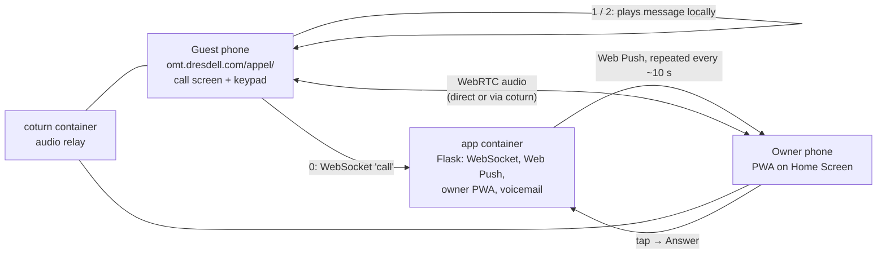

# Homemade solution — test project

> **Status: plan only, written 2026-10-19 on the work computer. Nothing built or tested yet.** To be built and tested at home (Docker + `omt.dresdell.com`).

## 1. What we're testing

A guest on the B&B web page taps **Appeler**. Their phone shows a screen that looks and sounds like a real phone call: a voice menu, a keypad, press **1** or **2** for information, press **0** to reach the owner. Pressing 0 alerts the owner's phone with a **Web Push notification**. The owner taps it, a PWA opens, and they talk. Everything goes over the internet: no phone number, no SIP, no Asterisk, **$0**.

**The one question this test must answer:** does a Web Push notification reliably get the owner's attention on a locked **iPhone** and on a locked **Android**, fast enough to answer a waiting guest?

Out of scope: paid ways to make the phone ring (Pushover, Groundwire, forwarding to a regular number). If free doesn't work well enough, the answer is the paid project (`zadarma-test-project.md`), not a paid add-on here.

## 2. How it works



- **The voice menu runs in the guest's browser.** The greeting and the messages for 1 and 2 play from the page itself. The server only gets involved when the guest presses 0.
- **The microphone is only requested when the guest presses 0.** People who only want information never see a microphone prompt.
- **Two containers:** `app` (Flask) and `coturn`. The guest page is static files placed on the existing `omt.dresdell.com` site.

## 3. What the guest sees (must look like a phone call)

| Screen | Content |
|---|---|
| B&B page | A button styled like a phone link: « 📞 Appeler le gîte » |
| Calling | Full-screen dark call screen: logo, « Gîte [nom] », status « Appel en cours… », a short ringback tone, then the timer starts (00:01…) |
| Menu | Greeting plays: « Bonjour… Pour réserver, faites le 1. Pour les informations d'arrivée, faites le 2. Pour parler à quelqu'un, faites le 0. » Bottom buttons: **Muet**, **Clavier**, **Raccrocher** (red). The keypad (1–9, *, 0, #) plays real phone key tones. |
| Key 1 / 2 | Plays the message and shows a card with the link (booking site, check-in page), then returns to the menu |
| Key 0 | « Je vous transfère. » → microphone prompt → ringback tone (North American: 440 + 480 Hz, 2 s on, 4 s off) → status « Sonnerie… » |
| Connected | Status « En ligne avec [prénom] », timer restarts |
| No answer after 45 s | « Laissez un message après le bip. » → beep → recording (max 60 s) → sent when the guest hangs up or time runs out |
| Ended | « Appel terminé — 01:23 » and the links again |

The ringback and key tones are generated in the browser (Web Audio). For tonight, the French voice can be the browser's built-in text-to-speech (`speechSynthesis`, `fr-CA` voice if present). Replace it later with recorded MP3s (your own voice, or Piper on a Pi).

## 4. What the owner sees

- **Setup once:** open `https://omt.dresdell.com/call/owner/` → enter the passcode → **Add to Home Screen** → open it from the Home Screen → tap **Activer les notifications**.
- **Guest presses 0:** notification « 📞 Un client attend — touchez pour répondre », sent again every ~10 s until answered or 45 s have passed.
- **Tap the notification:** the PWA opens on an incoming-call screen (caller « Client du site web », green **Répondre**, red **Refuser**). If the PWA is already open, it plays a ringtone loop and shows the same screen.
- **After a missed call:** notification « Nouveau message vocal ». It opens the PWA, where the message can be played.

**Answer** needs a tap inside the PWA because iPhone only starts audio after a tap.

## 5. Home setup

### 5.1 What you need

| Item | Notes |
|---|---|
| Docker host at home | Any (PC, NAS, or Pi 4/5: both images are multi-architecture) |
| `omt.dresdell.com` with a valid certificate | Already in place. HTTPS is required for the microphone, Web Push and installing the PWA. |
| The reverse proxy in front of `omt.dresdell.com` | **Fill in:** nginx / Caddy / Traefik / Nginx Proxy Manager? |
| Router access | For 3 port forwards (below) |
| Test phones | Android (at home) and an iPhone (yours or the friend's), plus a second phone or a computer to play the guest |

### 5.2 Ports to forward on the router (to the Docker host)

| Port | Protocol | For |
|---|---|---|
| 443 | TCP | Already forwarded for `omt.dresdell.com` |
| 3478 | UDP + TCP | coturn |
| 49160–49200 | UDP | coturn audio relay (~4 ports per call; 40 ports is plenty) |

Also note the home public IP for coturn's `external-ip`. If it changes often, see section 9.

### 5.3 URLs (single domain, so no cross-origin issues)

| URL | Served by |
|---|---|
| `https://omt.dresdell.com/appel/` | Guest page: static files copied onto the existing site |
| `https://omt.dresdell.com/call/` | Reverse proxy → `app` container (WebSocket, API, owner PWA under `/call/owner/`) |

Example for **nginx** (adapt to the actual proxy):

```nginx
location /call/ {
    proxy_pass http://127.0.0.1:8080/;
    proxy_http_version 1.1;
    proxy_set_header Upgrade $http_upgrade;
    proxy_set_header Connection "upgrade";
    proxy_set_header Host $host;
    proxy_set_header X-Forwarded-For $proxy_add_x_forwarded_for;
    proxy_read_timeout 3600s;
}
```

### 5.4 Files to build

```text
homemade/
├── docker-compose.yml
├── .env                      # secrets (never commit)
├── turnserver.conf
├── app/
│   ├── Dockerfile            # python:3.12-slim, non-root, gunicorn 1 worker + threads
│   ├── requirements.txt      # flask, flask-sock, pywebpush, gunicorn
│   ├── app.py                # WebSocket, push, TURN credentials, voicemail
│   └── owner/                # owner PWA
│       ├── index.html  owner.js  owner.css
│       ├── manifest.webmanifest   # "display": "standalone", scope /call/owner/
│       ├── sw.js                  # push + notificationclick
│       └── icons/
└── guest/                    # copy to omt.dresdell.com/appel/
    ├── index.html  call.js  call.css
    └── audio/                # optional MP3 prompts (later)
```

`docker-compose.yml` (sketch):

```yaml
services:
  app:
    build: ./app
    restart: unless-stopped
    env_file: .env
    volumes:
      - ./data:/data              # push subscriptions (SQLite) + voicemails
    ports:
      - "127.0.0.1:8080:8080"     # only the reverse proxy reaches it
  coturn:
    image: coturn/coturn:latest
    restart: unless-stopped
    network_mode: host            # simplest for the UDP relay range
    volumes:
      - ./turnserver.conf:/etc/coturn/turnserver.conf:ro
```

`.env`:

```ini
PUBLIC_BASE=https://omt.dresdell.com
OWNER_PASSCODE=change-me
VAPID_PUBLIC_KEY=...            # reuse your existing PWA keys or generate new ones
VAPID_PRIVATE_KEY=...
VAPID_SUBJECT=mailto:you@example.com
TURN_SECRET=long-random-string  # same value as static-auth-secret below
TURN_URL=turn:omt.dresdell.com:3478
RING_TIMEOUT_S=45
PUSH_REPEAT_S=10
```

`turnserver.conf`:

```ini
listening-port=3478
fingerprint
use-auth-secret
static-auth-secret=long-random-string
realm=omt.dresdell.com
external-ip=YOUR.HOME.PUBLIC.IP
min-port=49160
max-port=49200
no-cli
no-multicast-peers
# Never relay into the home network
denied-peer-ip=10.0.0.0-10.255.255.255
denied-peer-ip=172.16.0.0-172.31.255.255
denied-peer-ip=192.168.0.0-192.168.255.255
denied-peer-ip=127.0.0.0-127.255.255.255
```

### 5.5 What `app.py` does

| Endpoint | Purpose |
|---|---|
| `GET /owner/…` | Owner PWA files |
| `POST /api/login` | Checks `OWNER_PASSCODE`, sets a cookie |
| `POST /api/push/subscribe` | Saves the owner's push subscription (owner only) |
| `GET /api/turn` | Returns short-lived TURN credentials (HMAC of `TURN_SECRET`, valid 10 min) |
| `WS /ws` | Call setup between guest and owner (messages below) |
| `POST /api/voicemail` | Guest uploads a message (iPhone records `audio/mp4`, Android/Chrome `audio/webm`: accept both); triggers a push |
| `GET /api/voicemail/<id>` | Owner only |

WebSocket messages (JSON, all carry the call `id` once it exists):

| From → to | `type` | Meaning |
|---|---|---|
| guest → server | `call` | Guest pressed 0. Server creates the call, starts pushing the owner, replies `ringing` |
| owner → server | `hello` | Owner PWA is open (rings in-app too) |
| owner → server | `accept` / `decline` | Owner's answer; server tells the guest `accepted` or `no-answer` |
| server → guest | `no-answer` | After `RING_TIMEOUT_S`; guest page switches to voicemail |
| both, relayed | `offer` / `answer` / `ice` | WebRTC setup; the guest sends the offer after `accepted` |
| both | `hangup` | Ends the call |

Calls live in memory (one gunicorn worker), which is fine for a test. Basic protection: rate-limit `call` per IP (e.g. 3 per 10 min), only one call at a time.

## 6. Build order (tonight)

1. **Push on the iPhone first, before writing anything new.** Install your existing PWA on the iPhone's Home Screen, lock the phone, send a push. If it doesn't arrive, stop: the homemade option fails on iPhone.
2. Containers up: `app` answers at `https://omt.dresdell.com/call/owner/`, coturn listening (`docker logs`).
3. Owner PWA: login, Add to Home Screen, notifications on, a "Test push" button.
4. Guest page: call screen, keypad, local menu (1, 2) — no server needed yet.
5. Key 0 → push → owner answers → audio both ways.
6. Voicemail when nobody answers.

## 7. Test script

Play the guest on a phone with **Wi-Fi off (cellular)**. Testing from inside the house over Wi-Fi with the public domain can fail if the router doesn't support NAT loopback, and it doesn't prove the relay works.

| # | Test | Expected | Result |
|---|---|---|---|
| H1 | Guest taps Appeler on iPhone Safari | Call screen, ringback, greeting in French | |
| H2 | Same on Android Chrome | Same | |
| H3 | Keys 1 and 2 | Message plays, link card shows, back to menu | |
| H4 | Key 0, owner **Android** locked, screen off | Notification within 5 s, repeats every ~10 s | |
| H5 | Key 0, owner **iPhone** locked (PWA on Home Screen) | Notification within 5 s, repeats every ~10 s | |
| H6 | Owner taps notification → Répondre | Audio both ways within 3 s of the tap | |
| H7 | Repeat H5 10 times over the evening | Notification arrives ≥ 9/10 times | |
| H8 | Owner iPhone in **Focus / Do Not Disturb** | Note what happens (and whether allowing the PWA in Focus fixes it) | |
| H9 | Guest locks screen or switches app during the call | Note whether the call survives | |
| H10 | Nobody answers 45 s | Beep, recording, owner gets « Nouveau message vocal », plays it | |
| H11 | Guest on desktop Chrome | Works the same | |
| H12 | Audio quality, 2-minute call on cellular both sides | Note: clear / choppy / one-way | |

## 8. Pass / fail

- **Pass:** H1–H6 work, H7 ≥ 9/10 on the iPhone, and H12 is clear. → The homemade option is viable at **$0/month**.
- **Fail:** iPhone notifications are missed, late (> 10 s), or easy to miss in a pocket. → Free Web Push isn't enough to replace a phone that rings; recommend the paid project.

## 9. Known risks / to check

- **iPhone Web Push** needs iOS 16.4+, the PWA installed on the Home Screen, and permission requested from a tap inside it. Each push must show a notification (no silent pushes). Not re-checked today.
- **Repeated pushes:** confirm iPhone plays a sound for each one. If notifications with the same `tag` are merged silently, use a different `tag` per push.
- **iPhone as guest:** no vibration API; audio may play through the loudspeaker instead of the earpiece. Note it in H1.
- **Home public IP changes:** coturn's `external-ip` must be updated (or use a dynamic DNS and a small script). Not a problem later on the VPS.
- **Home uptime:** fine for a test. For the friend's real use, move the same compose file to the VPS.

## 10. Cost

| Item | At home (test) | On the VPS (real use) |
|---|---|---|
| Software | $0 (all open source) | $0 |
| Server | Existing Docker host | Existing VPS |
| Domain + certificate | Existing | Existing |
| Phone number | None | None |
| **Total** | **$0/month** | **$0/month extra** |

## 11. Scorecard (same rows as the Zadarma test, for the recommendation)

| Criterion | Result |
|---|---|
| Locked iPhone owner gets the call (≥ 9/10) | |
| Locked Android owner gets the call | |
| Guest screen looks like a phone call | |
| Guest can press 1 / 2 / 0 | |
| People can dial a regular phone number | No (web only) |
| Setup time (actual) | |
| Monthly cost | $0 |
| Who maintains it | You (server, updates) |
| Friend can change messages alone | |
