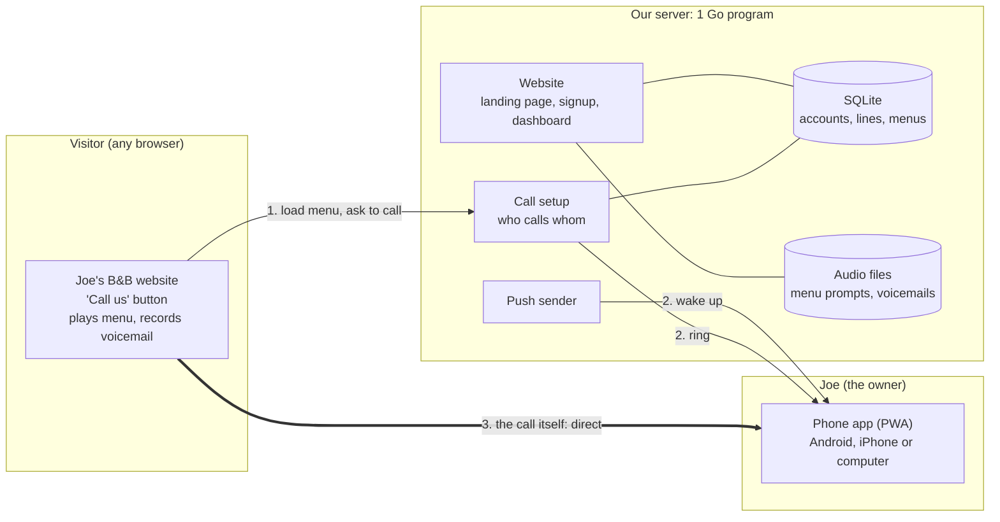
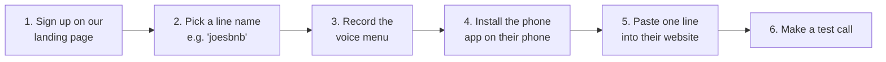
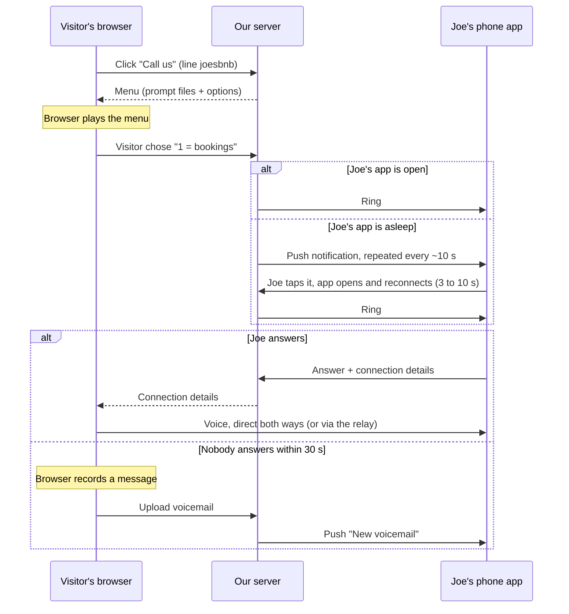
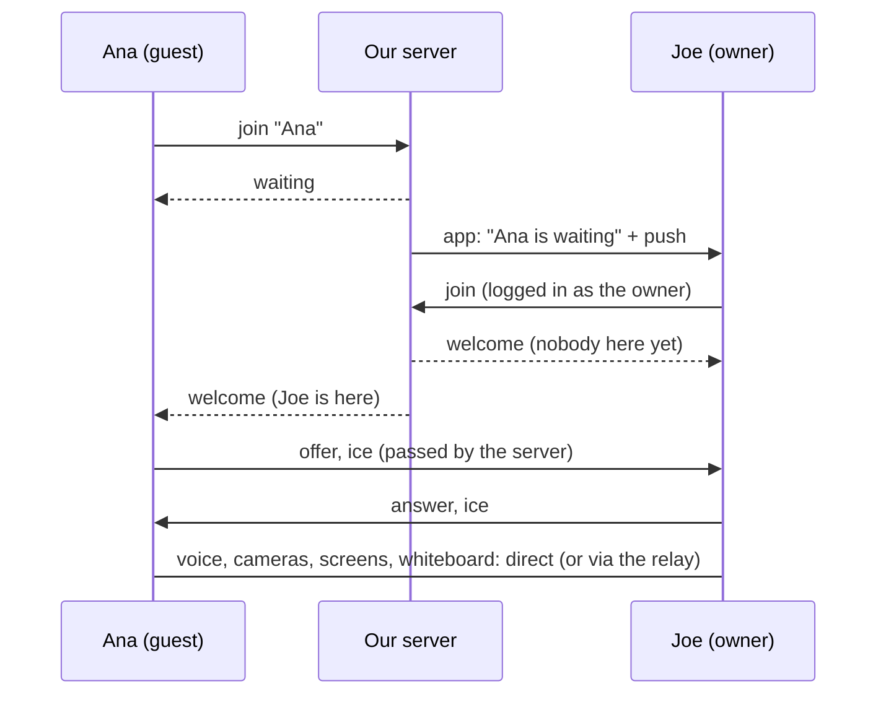
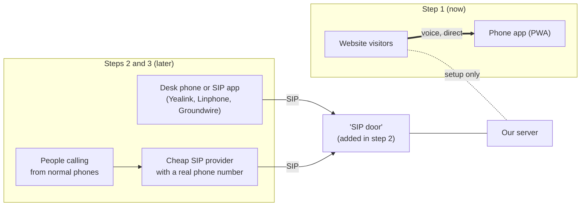

# Architecture

Last update: 2026-10-21 · Status: design decided, no code yet. Build steps: [plan.md](plan.md). Background: [research.md](research.md).

Diagrams use Mermaid. GitHub shows them as pictures. In VS Code, install the "Markdown Preview Mermaid Support" extension.

## In one sentence
A small business (example: Joe's B&B) signs up on our website, gets a line, installs our phone app and pastes one line of code into their own website. Visitors can then click "Call us", hear Joe's voice menu and talk to Joe's phone, or leave a voicemail.

## Decisions so far
| Topic | Decision | Why |
|---|---|---|
| Language | **Go** for everything (website, dashboard, call setup) | Light on RAM, one file to deploy, handles thousands of waiting phones easily. And the owner wants to learn Go. |
| Web pages and components | **templ** + **shadcn-templ** + Tailwind v4 | shadcn look, the most popular Go option (see [research.md](research.md#web-components-for-go)) |
| Voice during a call | **Direct between visitor and phone**; our server isn't in the middle | A connected call keeps working even if the home server or its internet goes down. No call recording needed. |
| Voice menu and voicemail (web callers) | Run **in the visitor's browser** | So the server never handles audio |
| Database | **SQLite** (one file) | No database server to run |
| Real phone lines | **Not in the first version**; planned for later | See "Growing later" |
| Container | **Later.** Develop locally first with auto-reload. | See [plan.md](plan.md) |
| Hosting | Owner's own server (has DNS and a firewall) | |

## The big picture

1. The visitor clicks "Call us". Their browser downloads Joe's menu (prompt recordings plus options) and plays it.
2. The visitor picks "1 = booking". The server rings Joe's phone app, and sends a push notification if the app is asleep.
3. Joe answers. **From here the voice goes directly between the two devices.** The server only passed the "hello, here's how to reach me" messages.
4. If nobody answers within 30 s, the visitor's browser records a voicemail and uploads it. The server pushes "New voicemail" to Joe.

**The relay (TURN), and why we still need one.** On some networks (often 4G or strict office Wi-Fi), the two devices can't connect directly. The voice then has to go through a relay. Two choices:
- **Built into our program** with `pion/turn`. Free, but those relayed calls depend on the home server.
- **Hosted relay service** (Cloudflare, Metered, Twilio). Pay per GB, and relayed calls don't depend on the home server.

Start with the built-in one and switch only if it becomes a problem. Most calls won't need it.

## What Joe does (the customer journey)

1. **Sign up** at `minivoip.example` with an email and password.
2. **Pick a line name**, for example `joesbnb`. That gives Joe:
   - a call link: `minivoip.example/joesbnb`, which works anywhere (Google Maps listing, Facebook, email signature, QR code on the front door),
   - a short extension number, for example `1001`, used later for desk phones and real numbers.
3. **Record the menu** in the dashboard (microphone or file upload). Example: "Press 1 for bookings, 2 for anything else." Optional: opening hours.
4. **Install the phone app** on each phone that should ring (see below).
5. **Add the button** to the website (see below).
6. **Test** with the "Try it" button on the dashboard's Home tab.

## Installing the phone app
The phone app is a web app that installs from the browser (a PWA, or "progressive web app"). On Android, the minivoip app (`android/`, downloaded from the app's account page at `/download/minivoip.apk`) shows the same pages and rings like a real phone call; see `docs/vision.md`.

| Joe's device | Steps | How ringing works |
|---|---|---|
| **Android** (the minivoip app) | Open `minivoip.example/app` in Chrome, the account (round letter), "Get the Android app", install it, log in, allow notifications and microphone | Rings like a phone call (ringtone until answered, call screen over the lock screen), through Firebase. |
| **Android** (Chrome only) | Open `minivoip.example/app`, log in, tap "Install", allow notifications and microphone | Weak: a silent notification (Ken's Pixel 9 test, 2026-10-24). |
| **iPhone** (iOS 16.4 or newer) | Open `minivoip.example/app` in **Safari**, tap Share, then "Add to Home Screen". Open it **from the home-screen icon**, log in, allow notifications and microphone | Weaker. A single notification sound, no ringtone, no full-screen call screen. Joe taps it, the app opens in a few seconds, and Joe answers. |
| **Computer** (Chrome, Edge, Firefox) | Open `minivoip.example/app`, log in, allow notifications and microphone | Good while the browser is running |

Several devices can be on the same line. They all ring, and the first to answer takes the call.

The iPhone limit comes from Apple. We stay a web app on every device (decided 2026-10-22, see [vision.md](vision.md)), so the fix is guidance and fallbacks, not a store app; a SIP app such as Groundwire (step 2 under "Growing later") stays an option.

## Putting the button on a website
Joe pastes this one line into the website, just before `</body>`:
```html
<script src="https://minivoip.example/w.js" data-line="joesbnb" async></script>
```
- The dashboard shows this line with Copy. It adds a button in the corner that says whether Joe is here ("Talk to us now") or away ("Leave us a message"), read from `GET /api/status/<line>` (open to any website) every minute. Here means: the Available switch is on, a choice rings, and a phone can ring (an open app, or one that gets pushes).
- On another site, the call opens in its own browser window (security review, 2026-11-02: a permission given inside a frame belongs to the website around it). On our own landing page it opens in a window over the page (a modal `<dialog>` with an `<iframe>` from **our** domain, allowed the microphone and camera), so the website never touches the microphone and needs nothing else installed. The page behind is dimmed and blurred. On a phone it opens our call page full screen. The site's own links with `data-minivoip-call` open the same window; the minivoip landing page uses that for "Call us now".
- Website builders all have a place for it: WordPress ("Custom HTML" block), Wix ("Embed code"), Squarespace ("Code" block), Shopify (theme code).
- **Joe can't edit the website?** Use the call link `minivoip.example/joesbnb` instead, as a normal link, a QR code or a Google Maps "website" link.

## The stack
| Part | What it does | Built with |
|---|---|---|
| **Web server** | Serves every page, the app, `w.js`, the API | Go standard library (`net/http`) |
| **Pages and components** | Landing page, signup, dashboard, phone app screens, call window | [templ](https://github.com/a-h/templ) (Go's component templates) + [shadcn-templ](https://github.com/axadrn/shadcn-templ) (shadcn/ui components for templ, copied into the project) + Tailwind CSS v4.1+ (standalone program, no Node needed) |
| **Small dynamic bits** | Saving a form without a page reload, refreshing a list | Plain JavaScript first; add [htmx](https://htmx.org/) only if it helps |
| **Phone app (PWA)** | Rings, answers, plays voicemails | The same pages plus a manifest and a service worker (the parts that make it installable and let it receive push) |
| **Call button + call window** | Plays the menu, makes the call, records voicemail | Plain JavaScript; the browser's built-in WebRTC handles the voice |
| **Call setup messages** | "Visitor wants joesbnb", "Joe answered", connection details | WebSockets via [`coder/websocket`](https://github.com/coder/websocket) |
| **Push sender** | Wakes the phone app | [`SherClockHolmes/webpush-go`](https://github.com/SherClockHolmes/webpush-go) with the free web-push standard (VAPID keys kept in `.env`) |
| **Relay (TURN)** | Carries voice when a direct connection fails | [`pion/turn`](https://github.com/pion/turn) inside our program (or a hosted service, see above) |
| **Database** | Accounts, lines, devices, menus, voicemail list | SQLite via [`modernc.org/sqlite`](https://gitlab.com/cznic/sqlite) (pure Go, one file) |
| **Audio files** | Menu prompts, voicemails | A folder (`data/audio`) |
| **Login** | Passwords, sessions | `bcrypt` (`golang.org/x/crypto`) + login cookie |
| **Dev tools** | Auto-reload while coding | `task dev` (from shadcn-templ): templ watcher + Tailwind watcher + script bundler |
| **Later: HTTPS + container** | Running on the home server | Docker container + [Caddy](https://caddyserver.com/) (gets certificates automatically) or the existing proxy |

Not in the first version: payments, email sending (sign-up confirmation, password reset), several staff accounts per business, call recording.

## How a call works


## Video, screens, whiteboard and meeting rooms (2026-10-25)
Same rule as the voice: **the server only introduces people; everything else goes directly between browsers.**

- **In a call:** every call opens, up front, two video lanes (camera and screen) and a small data channel next to the
  voice. Turning a camera on fills a lane, with no new call setup. The data channel carries who has what on and the
  whiteboard's lines as they're drawn. Shared by the call window, the owner's app and the meeting room:
  `assets/js/meet.js` and `assets/css/stage.css`.
- **Meeting rooms:** `/room/<line>`, its socket `/ws/room?line=` (`calls/room.go`). Guests wait until the owner (the
  logged-in owner of the line) lets them in, one by one, and the owner can remove anyone: knowing the address isn't
  enough to hear a meeting. One seat stays the owner's. The owner's open apps see who waits (a "room" message on the
  call socket) and their phones get a "Someone is waiting in your meeting room" notification. Inside, everyone connects
  to everyone (a mesh): a newcomer gets the list of people there and offers a connection to each. That keeps the
  server out of the video, so a room fits 4 people; bigger rooms would need a forwarding server.
- Video through the relay costs more bandwidth than voice (roughly 1 to 2.5 Mbit/s per camera or screen, per person
  receiving it) on the home server's upload.



## Premium notes (2026-11-04)

A saved recording becomes a transcript, a summary and next actions (plan: [notes-plan.md](notes-plan.md)). One
background worker (`notes/worker.go`) does one note at a time; its queue is the `note` table, so a restart loses
nothing. It tries 4 times, waiting 1, 5, then 30 minutes. A transcript that came back is kept, so another try only pays
for the summary, and hours are counted only then.

- **Two services, each behind a small interface** (`Transcriber`, `Summarizer`), both with plain `net/http`; Go tests
  use fakes. Transcripts: ElevenLabs Scribe (`scribe_v2`, with who said what; it hears the language itself). About $0.22
  an hour according to third-party price lists in November 2026; check their own page. Summaries: Claude (`claude-opus-5-5`, with
  `fallbacks: "default"`: a request its safety checks decline runs on the model Anthropic picks). About $0.10 an hour of audio.
- **Keys** in `.env` (`ELEVENLABS_API_KEY`, `ANTHROPIC_API_KEY`, see `.env.example`; the Taskfile loads it). Without
  both, new notes are skipped and say so.
- **Limits, checked before any money is spent:** 10 hours per account per month, 20 hours a day across all accounts
  (`MINIVOIP_NOTES_DAY_HOURS`). A browser can't play a recording down: its size also says how long it can be.
- **Voicemails** (`store.NoteVoicemail`, called after the upload): Premium only. Under 2 seconds gets no note, so
  silence costs nothing. A line's voicemails get 30 notes a day; after that the message says why it has none, so a robot
  can't use up the owner's hours or everyone's day. The message itself always arrives, and its audio stays.
- **Callers are told first** (`lines.Notice`), when `Line.Notes` is on: Premium and "Take notes". In writing on every
  step of the call window, out loud before the menu (even a recorded one) and before the tone, written at the meeting room's
  door, in the room, and said to a guest pressing Join. In the account's language. A caller who presses a choice early
  still hears it before the phone rings. It is told whether or not the keys are set: saying too much is the safe side.
  There's no way to refuse but hanging up, or turning off "Take notes" as the owner. Not legal advice: the rules where
  the business operates apply.
- **The Notes tab** (`web/notes.go`, `pages/notes.templ`) is for the account's logged-in owner on Premium, checked on the
  server: someone else's note answers 404, and so does any note on Basic, whose tab shows only the Premium tag and how
  many notes are saved. Delete works on any plan. The "Take notes" switch is per account.
- **What people say is untrusted.** Claude gets no tools and only the one transcript, as JSON between tags (JSON writes
  `<` as `\u003c`, so a caller's words can't close the tag); its instructions say it's data, and its answer must fit a
  schema. The worst a caller can do is spoil the note of their own call. Transcripts never go in the logs, and the
  clients follow no redirect, so a key can't travel.
- **ElevenLabs keeps logs by default;** turning that off (`enable_logging=false`) is for its enterprise customers.

## Security rules (reviews of 2026-11-02)

- **The call address stays short and public** (`/call/ken`): it's printed on the business's website anyway, so a random
  one would protect nothing. The protection is what a stranger can do with it: ring within limits, leave a message
  within limits. Never listen, never log in, never join a meeting without the owner saying yes.
- **No account without a promo code** (`web.signup`), until payments exist. Codes can be random (empty field on the
  admin page), and need 8 characters at least. A line name matching `MINIVOIP_CALL_LINE` is for admins only.
- **Admins** are `user.is_admin` only, set with SQL.
- **The server binds 127.0.0.1.** A container sets `MINIVOIP_BIND` and must name its Caddy in `MINIVOIP_TRUSTED_PROXY`
  (addresses or networks), or the program refuses to start. Only this machine or a named proxy may say who the visitor
  is (`clientIP`). Never publish 8090 directly. Private addresses are exempt from limits only in development
  (`ExemptHomeNetwork`).
- **Limits count before the work, in one step** (`Window.Take`; `Give` hands it back): requests sent at the same moment
  can't slip through. At most half the CPU cores check passwords at once (`store.bcryptSlots`).
- **Push only goes to the browser makers' push services** (`push.AllowedEndpoint`), with a time limit and no redirects.
  Development allows `http://localhost`, only when registered from this machine or the home network (the browser test).
- **The relay isn't free for all.** A caller gets a login only when the owner answers (`accepted`), a guest only when let
  in (`welcome`), the owner by being logged in (`/api/ice`, 30 in 10 minutes); strangers get only the address helper.
  12 connections per address and 36 in total, about 8 Mbit/s each way per connection, 200 different peers per client
  (each costs memory), 20 TCP connections per address. Through our own public address, only live relay ports can be
  reached, never this machine or the router (`relay/hairpin.go`).
- **Recordings** have one of four types (`store.AudioType`), checked on upload and on serving, and are served sandboxed.
  A recording belongs to its account (table `prompt`). 40 per account at most; unused ones go after a day.
- **Voicemail:** the pass travels in a header and is checked before the body is read, then spent once the message
  arrived, so a caller on a bad connection can retry. 10 passes an hour per visitor on a line, 2 uploads at once, 4 MB a
  message, 300 messages a mailbox, 10 GB in all. Kept 90 days; past 200 on a line, the oldest **heard** ones go. An unheard
  message is never dropped for space. Call history a year (`Store.Cleanup`, daily).
- **Text** has limits: business 100, choice name 80, spoken message 2000, web address 2000, email 254, so one customer
  can't make the public call page huge.
- **Every response** has the browser rules (`web/secure.go`): scripts only from this site and none inline, `nosniff`, HSTS
  over HTTPS, no framing, except `/call/` on our own pages. Requests are capped at 16 MB, plain forms at 64 KB. Sockets
  write through their own queue and close without waiting (`calls/conn.go`), so a stuck browser can't hold anyone up; a
  socket sending over 300 messages in 10 seconds is closed.
- **The Call button on another site** opens the call in its own window (`w.js`), so the microphone permission belongs to
  minivoip and never to that website, which has no hold on the window. Only our own landing page uses the window over the
  page.
- **In a call,** everything from the other person's browser is checked (`Link.receive`, `Board.receive` in `meet.js`). On a
  Basic line, video, screens and the whiteboard are ignored on both sides. A guest's name comes from the server, and a
  caller can't rename themselves.
- **Meeting room door:** one seat for the owner; 10 waiting, 2 from one address, for 10 minutes; declined or removed waits 5
  minutes to knock again. Owner status is checked again on joining, and open owner sockets every 10 minutes.
- **Logins:** the database keeps only a hash of the session token. Change password logs out the other devices and stops
  notifications to all of them; a socket whose login ended is closed. 5 wrong passwords from a visitor, 100 on an account,
  in 15 minutes. A browser that already logged in to the account carries a signed mark (`mv_known`, a year) and skips the
  account limit, so strangers with many addresses can't lock its owner out; a new browser can still wait out the 15 minutes.
  The mark follows the account's password. Behind HTTPS both login cookies are named `__Host-` and the plain name is
  ignored, so another dresdell.com site can't set them. Emails are plain letters only, so no look-alike account.
- **IPv6:** a visitor is a /64, and a whole /48 shares a budget too: 3 times a visitor's on a line (calls, messages,
  knocks), 10 times across the site (passwords, sign ups, lookups), 5 times for what is open at once.
- **Past a line's wake budget** one call in 5 minutes still wakes the phones, so 20 addresses can't silence a line.
- **A line takes 60 messages a day** from anyone, at most 300 or 400 MB, so filling a mailbox takes days and the owner sees
  it coming; sizes are in the database, so the check never reads the disk while the call hub is locked.
- **Relay:** 8 connections per login, and each login is its own, so one answered call can't take it from several
  addresses. Together all connections stop at about 48 Mbit/s each way.
- **Whiteboard:** 400,000 numbers from others per board, so a caller can't freeze the owner's tab.
- **A caller's video and screen** wait for the owner's tap ("Show their video") in each call. Nothing from the owner
  reaches a stranger unless the owner turns it on.
- **Fonts** are served from this site (`assets/fonts/`, `assets/css/fonts.css`), so no outside site sees a visitor's address.
- **Android, over the lock screen,** shows only the call; the lock comes back when there is none (8 seconds if it never
  arrives), Back leaves, and the Answer pass works once. The web view stays hidden until the page has taken the call and
  hidden its tabs; if that doesn't happen in 10 seconds, the app leaves.
- **Not fixed, on purpose:** no email is checked at sign up and there is no "forgot password", because the server can't
  send email yet. People in a call or a room see each other's internet address, because the connection is direct. There
  is no "delete my account" yet.

## Limits against robots and pranks (2026-10-28)

A call link is public, so anyone (robots too) can press Call. The server counts, per visitor address, in memory
(`web/limits.go`, forgotten on restart; IPv6 visitors count by their /64, and a whole /48 shares a budget too):

| What | Limit | Past it |
|---|---|---|
| A visitor calling one line | 3 in 10 minutes, 12 a day | Voicemail without ringing, not in the call history |
| Different networks waking one line's phones | 20 an hour (IPv6 by /48) | One call in 5 minutes still wakes them; the others ring open apps only, or with none open go to voicemail. The owner gets one "Many calls at once" notice an hour |
| A guest knocking on a meeting room | 3 in 10 minutes, 20 an hour on the line | Still waits, but the owner's phone isn't woken again |
| A visitor leaving messages on one line | 3 an hour | "Please try again later", no voicemail |
| Different networks leaving messages on one line | 20 an hour | Same |
| Messages left on one line, by anyone | 60 a day; the mailbox holds 300 or 400 MB | Same |
| Voicemail passes to a visitor on one line | 10 an hour | Same |
| Voicemail uploads under way from one visitor | 2 | Same |
| Wrong passwords from one visitor | 5 in 15 minutes | Waits 15 minutes, even with the right password |
| Wrong passwords on one account, from anywhere | 100 in 15 minutes | Waits 15 minutes |
| New accounts from one visitor | 3 an hour | "Please try again in an hour" |
| Refused sign ups from one visitor | 10 an hour | Same |
| Call pages, status checks and sockets from one visitor | 300 in 10 minutes | "Too many requests" |
| Sockets open from one visitor | 20 | "Too many connections" |
| Relay logins to a logged-in owner | 30 in 10 minutes | Plain STUN: most calls still connect |
| "Send a test" notifications from one account | 10 an hour | "That's enough tests for now" |

The visitor's address comes from Caddy's `X-Forwarded-For` (Caddy writes it, so a visitor can't fake it). Visitors on
the same machine or the home network aren't limited: the tests, and Ken's own phone. Not yet: a "verify you're
human" check (an outside service, Ken's call).

## The voice menu
The owner records each prompt. Every option points to one action:

| Action | Does |
|---|---|
| `ring` | Rings one or more devices; the first to answer wins |
| `play` | Plays a message, then hangs up (e.g. "check-in is at 3 pm") |
| `voicemail` | Goes straight to voicemail |
| `link` | Opens a web page (e.g. booking site); web callers only |
| `menu` | Goes to a sub-menu |

Web visitors choose by clicking buttons on screen.

The owner edits all of it on "What callers hear" (dashboard and phone app): the welcome, the choices and the voicemail
greeting. One voicemail greeting serves a missed call, a call while away and a `voicemail` choice. A recorded welcome
replaces the spoken list, so the page writes out the words to say.

## Data stored
Exact columns: [data-dictionary.md](data-dictionary.md). Built so far: `account`, `user`, `session`, `line`, `menu_option`, `promo_code`.

| Table | Holds |
|---|---|
| `account` | One customer (e.g. Joe's B&B): name, plan, created date |
| `user` | A person who logs in: email, password hash, which account |
| `line` | Line name (`joesbnb`), extension (`1001`), opening hours, first menu step |
| `device` | A phone or computer that can ring: push subscription, last seen |
| `menu_option` | One menu choice: key, name, action, message, web address (one level for now; sub-menus later) |
| `voicemail` | Caller, time, length, audio file, listened yes/no |
| `call_log` | Time, line, answered/missed/voicemail, length |
| `promo_code` | Code, plan it gives (Basic or Premium), valid from/to, max uses, times used, revoked yes/no. A valid code makes a line free forever. Created and revoked by Ken on an admin page, where he also switches any account between Basic and Premium (`account.plan`). |
| `session` | A login (cookie token, expiry) |
| `note` | Premium's record of a call, room or voicemail: transcript, summary, next actions, how far along it is |
| `note_usage` | How much audio each account's notes covered each day, for the limits |
| *later:* `sip_login` | Username and password for a desk phone or SIP app (step 2) |
| *later:* `phone_number` | A real number from the SIP provider, pointing to a line (step 3) |

## Growing later


| Step | What changes for Joe | What we add to the server |
|---|---|---|
| **1. Now** | Website button + phone app | What's described above |
| **2. Real desk phone or SIP app** | Joe types the server, extension `1001` and a password into a desk phone or a SIP app. Apps like Groundwire ring properly on iPhone (full-screen, ringtone). | A "SIP door": accepts desk phones (SIP registrar) and converts the voice format (browsers use Opus, desk phones use G.711) |
| **3. Real phone number** | Joe gets a real number. People call it from any phone and hear the same menu and get the same voicemail. | Connect the SIP door to a cheap SIP provider (VoIP.ms, Zadarma, Telnyx: a few dollars a month per number plus per-minute charges). The server also needs to play the menu and record voicemail itself, because phone callers have no browser. It reads the same menu data. |

**For SIP calls only, the server is in the middle**, because the voice format has to be converted. Web calls stay direct.

**Options for the SIP door (decide at step 2, not now):**

| Option | Size | Notes |
|---|---|---|
| [`emiago/sipgo`](https://github.com/emiago/sipgo) + [`diago`](https://github.com/emiago/diago) inside our Go program | Smallest: still 1 program | Go SIP libraries (BSD-2 and MPL-2.0). Young, and the API is still changing. Voice format conversion needs the Opus C library. |
| [`livekit/sip`](https://github.com/livekit/sip) | 3 more parts: LiveKit server, Redis, SIP service | Apache-2.0, Go, handles SIP providers well. Built for provider lines, not desk-phone registration. |
| Asterisk or FreeSWITCH | 1 big extra container | Does everything, but it's a whole phone system with its own config language. The fallback only. |

## Firewall / ports (home server, once deployed)
| Port | For what | When |
|---|---|---|
| 443 TCP | Website, app, call setup (HTTPS) | Step 1 |
| 3478 UDP + TCP | Relay: finding a path between visitor and phone | Step 1, only with the built-in relay |
| 49160–49200 UDP | Relay: carrying the voice when a direct path fails | Step 1, only with the built-in relay |
| 5060 UDP/TCP, 5061 TLS | SIP: desk phones and the SIP provider | Step 2 |
| 10000–10100 UDP | Voice for SIP calls | Step 2 |

During local development, nothing needs opening: the app runs on `localhost`.

## Still to confirm
- iPhone push: how fast the app reconnects after the tap. Test on a real iPhone early.
- How often calls need the relay: test from a phone on 4G and from an office network.
- shadcn-templ is a 2.0 beta. If it breaks, fall back to v1 (templUI).
- At step 2: whether diago's desk-phone and provider features are ready, or whether livekit/sip is the safer choice.
