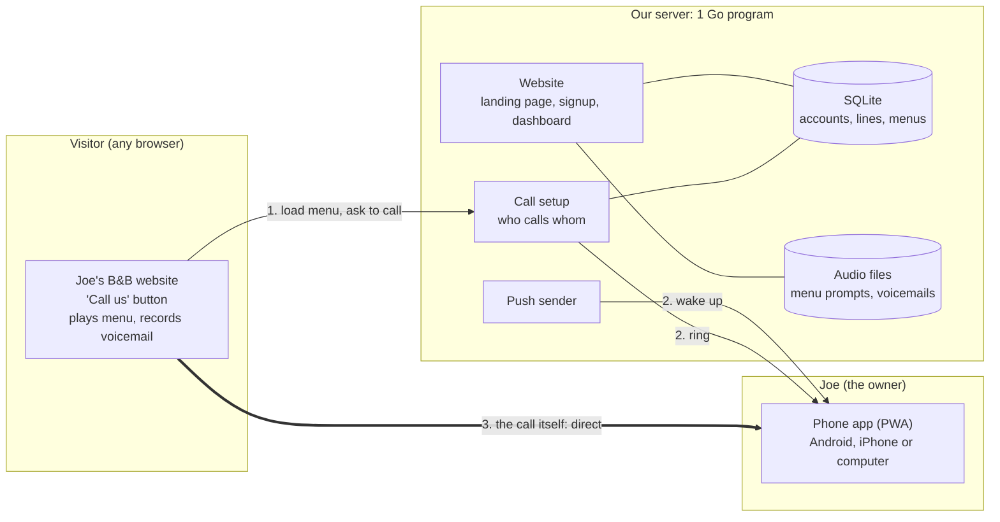
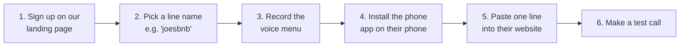
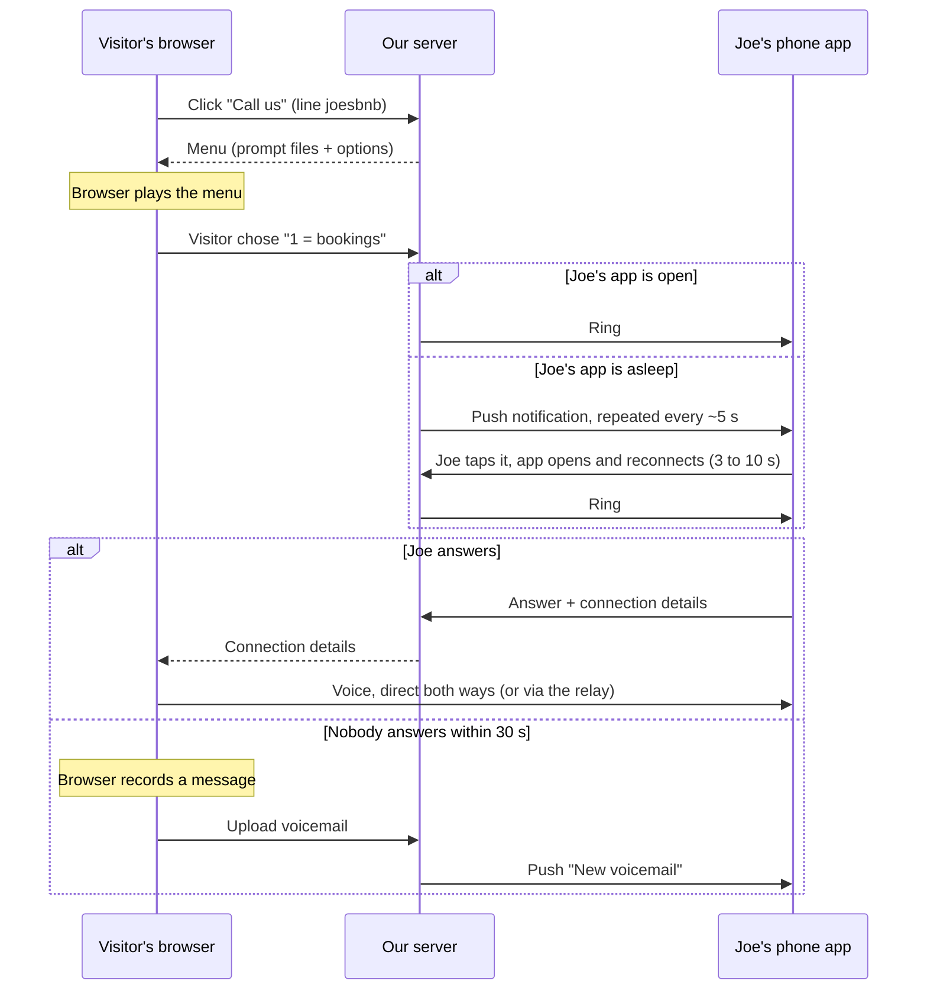
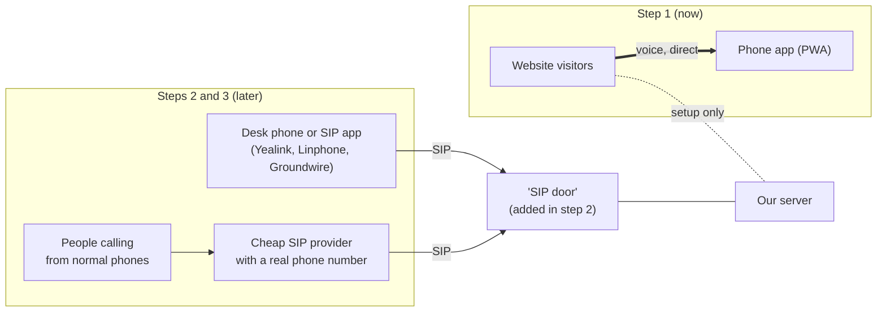

# Architecture

Last update: 2026-10-21 · Status: design decided, no code yet. Build steps: [plan.md](plan.md). Background: [research.md](research.md).

Diagrams use Mermaid. GitHub shows them as pictures. In VS Code, install the "Markdown Preview Mermaid Support" extension.

## In one sentence
A small business (example: Joe's B&B) signs up on our website, gets a line, installs our phone app and pastes one line of code into their own website. Visitors can then click "Call us", hear Joe's voice menu and talk to Joe's phone, or leave a voicemail.

## Decisions so far
| Topic | Decision | Why |
|---|---|---|
| Language | **Go** for everything (website, dashboard, call setup) | Light on RAM, one file to deploy, handles thousands of waiting phones easily. And the owner wants to learn Go. |
| Web pages and components | **templ** + **shadcn-templ** + Tailwind v4 | shadcn look, the most popular Go option (see [research.md](research.md#web-components-for-go)) |
| Voice during a call | **Direct between visitor and phone**; our server isn't in the middle | A connected call keeps working even if the home server or its internet goes down. No call recording needed. |
| Voice menu and voicemail (web callers) | Run **in the visitor's browser** | So the server never handles audio |
| Database | **SQLite** (one file) | No database server to run |
| Real phone lines | **Not in the first version**; planned for later | See "Growing later" |
| Container | **Later.** Develop locally first with auto-reload. | See [plan.md](plan.md) |
| Hosting | Owner's own server (has DNS and a firewall) | |

## The big picture

1. The visitor clicks "Call us". Their browser downloads Joe's menu (prompt recordings plus options) and plays it.
2. The visitor picks "1 = booking". The server rings Joe's phone app, and sends a push notification if the app is asleep.
3. Joe answers. **From here the voice goes directly between the two devices.** The server only passed the "hello, here's how to reach me" messages.
4. If nobody answers within 30 s, the visitor's browser records a voicemail and uploads it. The server pushes "New voicemail" to Joe.

**The relay (TURN), and why we still need one.** On some networks (often 4G or strict office Wi-Fi), the two devices can't connect directly. The voice then has to go through a relay. Two choices:
- **Built into our program** with `pion/turn`. Free, but those relayed calls depend on the home server.
- **Hosted relay service** (Cloudflare, Metered, Twilio). Pay per GB, and relayed calls don't depend on the home server.

Start with the built-in one and switch only if it becomes a problem. Most calls won't need it.

## What Joe does (the customer journey)

1. **Sign up** at `minivoip.example` with an email and password.
2. **Pick a line name**, for example `joesbnb`. That gives Joe:
   - a call link: `minivoip.example/joesbnb`, which works anywhere (Google Maps listing, Facebook, email signature, QR code on the front door),
   - a short extension number, for example `1001`, used later for desk phones and real numbers.
3. **Record the menu** in the dashboard (microphone or file upload). Example: "Press 1 for bookings, 2 for anything else." Optional: opening hours.
4. **Install the phone app** on each phone that should ring (see below).
5. **Add the button** to the website (see below).
6. **Test** with the "Make a test call" button in the dashboard.

## Installing the phone app
The phone app is a web app that installs from the browser (a PWA, or "progressive web app"). There's no app store and no Apple or Google account needed.

| Joe's device | Steps | How ringing works |
|---|---|---|
| **Android** (Chrome) | Open `minivoip.example/app`, log in, tap "Install", allow notifications and microphone | Good. Notifications arrive even when the app is closed, repeated every ~5 s like a ring. |
| **iPhone** (iOS 16.4 or newer) | Open `minivoip.example/app` in **Safari**, tap Share, then "Add to Home Screen". Open it **from the home-screen icon**, log in, allow notifications and microphone | Weaker. A single notification sound, no ringtone, no full-screen call screen. Joe taps it, the app opens in a few seconds, and Joe answers. |
| **Computer** (Chrome, Edge, Firefox) | Open `minivoip.example/app`, log in, allow notifications and microphone | Good while the browser is running |

Several devices can be on the same line. They all ring, and the first to answer takes the call.

The iPhone limit comes from Apple. Fixes for later: wrap the app as a real app (Capacitor), or use a SIP app such as Groundwire (step 2 under "Growing later").

## Putting the button on a website
Joe pastes this one line into the website, just before `</body>`:
```html
<script src="https://minivoip.example/w.js" data-line="joesbnb"></script>
```
- It adds a "Call us" button. The call opens in a small window served from **our** domain, so the website never touches the microphone and needs nothing else installed.
- Website builders all have a place for it: WordPress ("Custom HTML" block), Wix ("Embed code"), Squarespace ("Code" block), Shopify (theme code).
- **Joe can't edit the website?** Use the call link `minivoip.example/joesbnb` instead, as a normal link, a QR code or a Google Maps "website" link.

## The stack
| Part | What it does | Built with |
|---|---|---|
| **Web server** | Serves every page, the app, `w.js`, the API | Go standard library (`net/http`) |
| **Pages and components** | Landing page, signup, dashboard, phone app screens, call window | [templ](https://github.com/a-h/templ) (Go's component templates) + [shadcn-templ](https://github.com/axadrn/shadcn-templ) (shadcn/ui components for templ, copied into the project) + Tailwind CSS v4.1+ (standalone program, no Node needed) |
| **Small dynamic bits** | Saving a form without a page reload, refreshing a list | Plain JavaScript first; add [htmx](https://htmx.org/) only if it helps |
| **Phone app (PWA)** | Rings, answers, plays voicemails | The same pages plus a manifest and a service worker (the parts that make it installable and let it receive push) |
| **Call button + call window** | Plays the menu, makes the call, records voicemail | Plain JavaScript; the browser's built-in WebRTC handles the voice |
| **Call setup messages** | "Visitor wants joesbnb", "Joe answered", connection details | WebSockets via [`coder/websocket`](https://github.com/coder/websocket) |
| **Push sender** | Wakes the phone app | [`SherClockHolmes/webpush-go`](https://github.com/SherClockHolmes/webpush-go) with the free web-push standard (VAPID keys kept in `.env`) |
| **Relay (TURN)** | Carries voice when a direct connection fails | [`pion/turn`](https://github.com/pion/turn) inside our program (or a hosted service, see above) |
| **Database** | Accounts, lines, devices, menus, voicemail list | SQLite via [`modernc.org/sqlite`](https://gitlab.com/cznic/sqlite) (pure Go, one file) |
| **Audio files** | Menu prompts, voicemails | A folder (`data/audio`) |
| **Login** | Passwords, sessions | `bcrypt` (`golang.org/x/crypto`) + login cookie |
| **Dev tools** | Auto-reload while coding | `task dev` (from shadcn-templ): templ watcher + Tailwind watcher + script bundler |
| **Later: HTTPS + container** | Running on the home server | Docker container + [Caddy](https://caddyserver.com/) (gets certificates automatically) or the existing proxy |

Not in the first version: payments, email sending (sign-up confirmation, password reset), several staff accounts per business, call recording.

## How a call works


## The voice menu
The owner records each prompt. Every option points to one action:

| Action | Does |
|---|---|
| `ring` | Rings one or more devices; the first to answer wins |
| `play` | Plays a message, then hangs up (e.g. "check-in is at 3 pm") |
| `voicemail` | Goes straight to voicemail |
| `link` | Opens a web page (e.g. booking site); web callers only |
| `menu` | Goes to a sub-menu |

Web visitors choose by clicking buttons on screen.

## Data stored
| Table | Holds |
|---|---|
| `account` | One customer (e.g. Joe's B&B): name, plan, created date |
| `user` | A person who logs in: email, password hash, which account |
| `line` | Line name (`joesbnb`), extension (`1001`), opening hours, first menu step |
| `device` | A phone or computer that can ring: push subscription, last seen |
| `menu_step` | One menu step: prompt audio file plus its options |
| `voicemail` | Caller, time, length, audio file, listened yes/no |
| `call_log` | Time, line, answered/missed/voicemail, length |
| `promo_code` | Code, valid from/to, max uses, times used, revoked yes/no. A valid code makes a line free forever. Created and revoked by Ken on an admin page. |
| *later:* `sip_login` | Username and password for a desk phone or SIP app (step 2) |
| *later:* `phone_number` | A real number from the SIP provider, pointing to a line (step 3) |

## Growing later


| Step | What changes for Joe | What we add to the server |
|---|---|---|
| **1. Now** | Website button + phone app | What's described above |
| **2. Real desk phone or SIP app** | Joe types the server, extension `1001` and a password into a desk phone or a SIP app. Apps like Groundwire ring properly on iPhone (full-screen, ringtone). | A "SIP door": accepts desk phones (SIP registrar) and converts the voice format (browsers use Opus, desk phones use G.711) |
| **3. Real phone number** | Joe gets a real number. People call it from any phone and hear the same menu and get the same voicemail. | Connect the SIP door to a cheap SIP provider (VoIP.ms, Zadarma, Telnyx: a few dollars a month per number plus per-minute charges). The server also needs to play the menu and record voicemail itself, because phone callers have no browser. It reads the same menu data. |

**For SIP calls only, the server is in the middle**, because the voice format has to be converted. Web calls stay direct.

**Options for the SIP door (decide at step 2, not now):**

| Option | Size | Notes |
|---|---|---|
| [`emiago/sipgo`](https://github.com/emiago/sipgo) + [`diago`](https://github.com/emiago/diago) inside our Go program | Smallest: still 1 program | Go SIP libraries (BSD-2 and MPL-2.0). Young, and the API is still changing. Voice format conversion needs the Opus C library. |
| [`livekit/sip`](https://github.com/livekit/sip) | 3 more parts: LiveKit server, Redis, SIP service | Apache-2.0, Go, handles SIP providers well. Built for provider lines, not desk-phone registration. |
| Asterisk or FreeSWITCH | 1 big extra container | Does everything, but it's a whole phone system with its own config language. The fallback only. |

## Firewall / ports (home server, once deployed)
| Port | For what | When |
|---|---|---|
| 443 TCP | Website, app, call setup (HTTPS) | Step 1 |
| 3478 UDP + TCP | Relay: finding a path between visitor and phone | Step 1, only with the built-in relay |
| 49160–49200 UDP | Relay: carrying the voice when a direct path fails | Step 1, only with the built-in relay |
| 5060 UDP/TCP, 5061 TLS | SIP: desk phones and the SIP provider | Step 2 |
| 10000–10100 UDP | Voice for SIP calls | Step 2 |

During local development, nothing needs opening: the app runs on `localhost`.

## Still to confirm
- iPhone push: how fast the app reconnects after the tap. Test on a real iPhone early.
- How often calls need the relay: test from a phone on 4G and from an office network.
- shadcn-templ is a 2.0 beta. If it breaks, fall back to v1 (templUI).
- At step 2: whether diago's desk-phone and provider features are ready, or whether livekit/sip is the safer choice.
