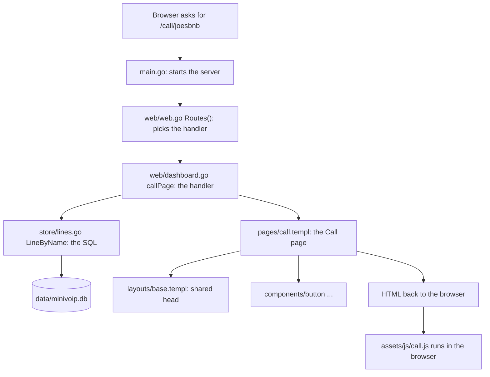
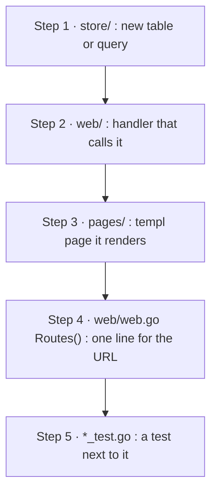

# Go for a Flask developer

A field guide for directing the AI on minivoip and reading what it writes. It skips syntax drills on purpose.
Every idea points to a real file in this repo, so you can open it and check.

---

## 1. The one-minute version

| Question | Flask world | Go world |
|---|---|---|
| What runs? | Python reads your `.py` files each time it starts | `go build` turns the code into **one file** (`bin/app`) that runs by itself |
| When do typos show up? | When that line runs (often in production) | At build time. If it builds, every name, type and argument matches |
| Web framework | Flask | **None needed.** The standard library (`net/http`) has routing, cookies, forms, static files |
| Templates | Jinja2 (`.html`, read at runtime) | **templ** (`.templ`, turned into Go code, checked at build time) |
| UI components | Your Jinja macros (shadcn-style) | **shadcn-templ**: the same idea, copied into `components/` |
| `pip install` | `pip install x`, `requirements.txt` | `go get x`, `go.mod` + `go.sum` |
| virtualenv | Needed per project | Not needed. Each project's `go.mod` pins its own versions |
| Dev mode | `flask run --debug` | `task dev` |
| Production server | gunicorn + several worker processes | **The app itself.** One process uses every CPU core |
| Container | Python image + your code + gunicorn | Copy one file into a tiny image |

**Why Go for minivoip:** it holds thousands of open connections (phone apps waiting for a call, WebSockets) in one
small process, ships as a single file, and catches the AI's mistakes at build time instead of in front of a customer.

**When not to pick Go:** quick data scripts, notebooks, machine learning, anything that lives on Python libraries.
Python stays the better tool there.

---

## 2. Install and the toolbox

Go is already installed here (`go version` shows 1.27). On a new Arch/Omarchy machine: `sudo pacman -S go`;
elsewhere, download it from go.dev/dl. Tools you install with `go install` land in `~/go/bin` (already on your PATH).

The `go` command is the whole toolbox. No pip, black, pytest or virtualenv to set up separately:

| You want | Python | Go |
|---|---|---|
| Add a library | `pip install requests` | `go get github.com/coder/websocket@latest` |
| Clean up unused libraries | edit requirements.txt by hand | `go mod tidy` |
| Install a command-line tool | `pipx install x` | `go install x@version`, or a `tool` line in `go.mod` (this repo does that for `templ`) |
| Run the code | `python app.py` | `go run .` |
| Build | (nothing) | `go build -o bin/app .` |
| Tests | `pytest` | `go test ./...` |
| Format | black | `gofmt` (every Go file in the world looks the same; no style debates) |
| Lint | flake8 | `go vet ./...` |

**`go.mod`** = `requirements.txt` + `pyproject.toml`: the project's name (`module minivoip`), the Go version, and
the libraries. Lines marked `// indirect` are libraries of libraries; ignore them.
**`go.sum`** = the lock file (fingerprints of every download). Never edit it; commit it.

Go culture leans on the standard library and adds few libraries. minivoip's own code uses a handful:
templ (pages), coder/websocket (call setup), modernc.org/sqlite (the database) and golang.org/x/crypto (bcrypt,
for passwords). Everything else in `go.mod` is pulled in by those.

---

## 3. The five ideas that make Go code readable

You don't need to write these. You need to recognise them.

### 3.1 A folder is a package

Every folder is one module of code, and its name is how other code calls it. `store.Open(...)` means "the `Open`
function in the `store/` folder". `main.go` is the special `main` package: the program starts at `func main()`.

### 3.2 Capital letter = public

`store.Open` starts with a capital, so other folders can use it. `s.migrate` starts lowercase, so it is private
to `store/`. Python's `_private` convention is a rule in Go, enforced by the compiler.

### 3.3 Structs and methods instead of classes

A `struct` is a class with data only: no inheritance. Functions attach to it as methods:

```go
type Server struct {          // web/web.go
    Store *store.Store
    Hub   *calls.Hub
    Dev   bool
}

func (s *Server) dashboard(w http.ResponseWriter, r *http.Request, u store.User) { ... }
//    ^ "s" is "self"
```

The `*` means "share this one, don't copy it". That's all you need to know about pointers to read the code.

### 3.4 Errors are return values, not exceptions

There is no `try/except`. A function that can fail returns the result **and** an error, and the caller checks it
right away:

```go
l, err := s.Store.LineByName(r.PathValue("line"))   // web/dashboard.go
if errors.Is(err, store.ErrNotFound) {
    http.NotFound(w, r)          // like abort(404)
    return
}
if err != nil {
    serverError(w, r, err)       // like abort(500), and logs it
    return
}
render(w, r, pages.Call(l))
```

`if err != nil { return ... }` is the most common line in Go. When you skim, skip those lines and the real story
is what's left. **Smell to watch for:** an AI that throws errors away (`_ = something()` or no `err` check),
except where a comment explains why.

### 3.5 Interfaces are "anything that has this method"

Anything with a `ServeHTTP(w, r)` method counts as a web handler, without declaring it. That's why the call
socket plugs straight into the router: `mux.Handle("GET /ws", s.Hub)`, because `calls.Hub` has a `ServeHTTP`.

### Smaller things you will meet

- `defer x.Close()`: runs when the function ends, like `finally` or `with`.
- `go doSomething()`: runs it in the background at the same time (a "goroutine"). Cheap; you can have thousands.
- `sync.Mutex` (`mu.Lock()` / `mu.Unlock()`): one goroutine at a time touches this data. See `calls/hub.go`.
- **Zero values:** an unset field is `""`, `0`, `false` or `nil`, never "undefined". `pages.AccountForm{}` is an
  empty form, ready to show.
- `` `json:"line"` `` after a field: the name it gets in JSON. See `callData` in `pages/call.templ`.
- `import _ "modernc.org/sqlite"`: imported only so it plugs itself in (the SQLite driver).
- An unused import or variable stops the build. Annoying for humans, great for catching AI leftovers.
- `any` = "any type" (Python's untyped variable).

---

## 4. How a request flows (Flask vs Go)



### Routes

```python
# Flask
@app.route("/call/<line>")
def call_page(line):
    ...
```

```go
// Go: web/web.go, all routes in one list
mux.HandleFunc("GET /call/{line}", s.callPage)

// web/dashboard.go: the handler
func (s *Server) callPage(w http.ResponseWriter, r *http.Request) {
    name := r.PathValue("line")
    ...
}
```

`w` is where you write the answer, `r` is the request. Every handler has this shape.

### The Flask-to-Go phrasebook

| Flask | Go (this repo) |
|---|---|
| `@app.route("/x", methods=["POST"])` | `mux.HandleFunc("POST /x", s.handler)` |
| `request.form["email"]` | `r.FormValue("email")` |
| `request.args.get("next")` | `r.URL.Query().Get("next")` |
| `<line>` in the URL | `r.PathValue("line")` |
| `render_template("x.html", a=1)` | `render(w, r, pages.X(1))` |
| `redirect(url_for("dashboard"))` | `http.Redirect(w, r, "/dashboard", http.StatusSeeOther)` |
| `abort(404)` | `http.NotFound(w, r); return` |
| `@login_required` | `s.auth(s.dashboard)` wraps the handler (`web/web.go`) |
| `current_user` | the `u store.User` the auth wrapper passes in |
| `g` / request context | `r.Context()` |
| `app.config` / `os.environ` | `os.Getenv("MINIVOIP_DB")` in `main.go` |
| `static/` folder | `assets/`, built into the binary (`assets/assets.go`, `//go:embed`) |
| Flask-SocketIO / flask-sock | `calls/hub.go` with `coder/websocket`, no extra server needed |

---

## 5. Templates: templ vs Jinja

The big shift: **a templ template is a function.** It has named, typed inputs, and the build fails if you pass the
wrong thing. Jinja takes a loose bag of variables and fails at runtime (or prints nothing) when one is misspelled.

### Passing variables

```python
# Flask
return render_template("dashboard.html", email=u.email, line=l, call_url=url)
```

```go
// Go: web/dashboard.go
render(w, r, pages.Dashboard(u.Email, l, baseURL(r)+"/call/"+l.Name))
```

```templ
// pages/dashboard.templ: the "template" declares what it needs
templ Dashboard(email string, l lines.Line, callURL string) {
    ...
    <h1>{ l.Business }</h1>
}
```

### Jinja to templ

| Jinja | templ |
|---|---|
| `{{ name }}` | `{ name }` (escaped automatically, safe against injection) |
| `…` | `if x { … }` |
| `` | `for _, o := range l.Options { … }` |
| `` + `` | `@layouts.Base("Title", "") { …page… }` and the layout prints `{ children... }` |
| `` / `{{ button(...) }}` | `templ brand() { … }` / `@brand()` |
| Your shadcn Jinja macros | `@button.Button(button.Props{...})` from `components/button/` |
| `href="{{ url }}"` | `href={ url }` (no quotes around the braces) |
| `{{ data \| tojson }}` | `@templ.JSONScript("id", data)` or a Go struct with json tags |

Look at `layouts/base.templ` (the shared `<head>`, like your `base.html`) and `pages/account.templ`
(`accountShell` is a small layout, `formField` is a macro). You already know this pattern; it's your own
component project with types added.

### The generated files

Each `x.templ` produces an `x_templ.go` next to it. That's the machine version, like a `.pyc` file.
**Never open or edit `*_templ.go`.** `task dev` regenerates them as you save.

### Components

`components/` holds shadcn-templ components (button, card, dialog, input, sidebar, table...). They're copied in,
so they're our code to change. Add more with `shadcn-templ add <name>`. Rule for the AI: reuse one of these
before writing new HTML widgets.

---

## 6. SQLite

| Flask habit | Go here |
|---|---|
| SQLAlchemy / `sqlite3` | `database/sql` (built into Go) + the `modernc.org/sqlite` driver |
| ORM models | Plain structs (`lines.Line`, `store.User`) filled from plain SQL |
| Flask-Migrate / Alembic | A numbered list of SQL scripts in `store/store.go` (`migrations`) |
| `db.session.commit()` | `tx.Commit()` |

Where to look:

- **The tables:** the `migrations` list at the top of `store/store.go`. At startup, `Open` runs any migration the
  file hasn't had yet (it counts them with SQLite's `user_version`). Rule: never edit a shipped migration, add a
  new one.
- **The queries:** one file per topic, `store/accounts.go`, `store/lines.go`. Every function is "one thing the app
  needs", like `CreateLine` or `LineByName`. Handlers never write SQL; they call these.
- **The file:** `data/minivoip.db` (not in git). The `-wal` and `-shm` files next to it are normal SQLite
  working files; leave them.

A typical read, so you recognise the shape:

```go
err := s.db.QueryRow("SELECT id, name, business FROM line WHERE name = ?", name).
    Scan(&id, &l.Name, &l.Business)    // copy the columns into variables, in order
```

The `?` placeholders keep it safe from SQL injection, same as in Python. Going further, a tool called **sqlc**
writes these Go functions from plain `.sql` files. Not needed yet; worth considering if `store/` grows large.

---

## 7. Which file do I open?

The map you'll use most.

| You're wondering... | Open |
|---|---|
| What URLs exist, and which ones need a login? | `web/web.go` → `Routes()` |
| What happens on a given URL? | find its handler name in `Routes()`, then that function in `web/*.go` |
| What a page looks like | `pages/<page>.templ` |
| The shared `<head>`, fonts, scripts | `layouts/base.templ` |
| A button, input, dialog... | `components/<name>/` |
| The database tables | `store/store.go` (`migrations`), explained in `docs/data-dictionary.md` |
| A query | `store/accounts.go`, `store/lines.go` |
| What a line and its voice menu are | `lines/lines.go` |
| How a call is set up (ring, answer, hang up) | `calls/hub.go` (server side) |
| What runs in the visitor's browser / the owner's phone | `assets/js/call.js`, `assets/js/phone.js` |
| Port, database path, dev mode | `main.go` |
| Dev and build commands | `Taskfile.yml` |
| Libraries | `go.mod` |
| Container | `Dockerfile` |
| Tests | `*_test.go`, next to the code they test |
| The design and its decisions | `docs/architecture.md`, `docs/plan.md` |
| Never open | `*_templ.go`, `assets/css/output.css`, `assets/js/shadcn-templ-*.js`, `bin/` (all generated) |

### Adding a feature: the usual path



That's the sentence to give the AI: *"Put the SQL in `store/`, the handler in `web/`, the page in `pages/`, add the
route in `Routes()`, and a test."* If a change doesn't fit this shape, ask why before accepting it.

---

## 8. Dev mode: the `flask run --debug` of Go

`task dev` (you run it in your own terminal) starts three watchers at once (see `Taskfile.yml`):

1. **templ**: when you save a `.templ` or `.go` file, it rebuilds and restarts the app (`go run`), then refreshes
   the browser. Open http://localhost:7331 (that address is the refreshing proxy; the real app is on 8090).
2. **tailwind**: rebuilds `output.css` when classes change.
3. **scripts-watch**: rebuilds the components' JavaScript bundle.

In dev mode the app also reads `assets/` from disk instead of from inside the binary, so CSS and JS changes show
up immediately.

**Where errors show up:**

- **Build errors** (typo, wrong type): in the `task dev` terminal. The page doesn't reload. Go prints the
  `file:line` to open.
- **Runtime errors**: `log.Printf` lines in the same terminal (see `serverError` in `web/web.go`). If something
  crashes inside one request (a "panic"), Go logs it and keeps serving everyone else.
- **Browser-side** (`call.js`, `phone.js`): the browser's developer console, as before.

There's no in-browser debugger like Werkzeug's. In Go you debug mainly with **tests**: `go test ./...` runs all of
them in a second or two, and `calls/hub_test.go` plays a whole call (ring, answer, hang up) without a browser.
For breakpoints, the VS Code Go extension uses **Delve** (`dlv`), Go's debugger. Optional; not installed.

---

## 9. Production and containers

### Why there's no gunicorn

Python runs one thing at a time per process (the GIL), so gunicorn starts several copies of the app to use
several cores. Go doesn't have that limit: **one process** gives every request its own goroutine and spreads them
over all cores by itself. No worker count to tune, no gevent for WebSockets. The binary *is* the production server.

One important consequence for minivoip: **run exactly one copy.** Two reasons:
- `calls/hub.go` keeps the ringing and live calls in memory. A second copy wouldn't know about them.
- SQLite is one file on one disk.

One Go process on a small server handles a lot of small businesses. When that stops being enough, it's an
architecture change (shared state, another database), not a gunicorn setting. `docs/architecture.md` covers
"growing later".

### What's in the `Dockerfile`

It's a **multi-stage build**, the standard Go pattern:

1. A big image with Go, Tailwind and Task builds everything (`task build`).
2. Only `bin/app` is copied into a tiny Alpine image. Final size: tens of MB, versus hundreds for a Python image.

`CGO_ENABLED=0` makes the binary fully self-contained, which is why we picked the pure-Go SQLite driver.
CSS, JS and logos are inside the binary (`//go:embed`), so nothing else needs copying.

### Good practices for Phase 6 (not done yet)

| Practice | Why | State today |
|---|---|---|
| Mount `data/` as a volume | the SQLite file must survive a container rebuild | not set up |
| Secrets as environment variables from `.env` | never baked into the image | `.env` is git-ignored |
| Run as a non-root user | limits damage if something breaks in | runs as root |
| Graceful shutdown | on stop, let calls and saves finish before exiting | `main.go` exits right away |
| Server timeouts (`http.Server`) | slow or stuck clients can't pile up | not set |
| A `/healthz` URL | lets Docker or the host check the app is alive | none |
| HTTPS in front (Caddy) | the app speaks plain HTTP; Caddy adds the certificate | how voip.dresdell.com works today |

Go reads the container's CPU limit and sizes itself to it, so there's nothing to tune there.

Bonus: Go builds for another machine from yours. `GOOS=linux GOARCH=arm64 go build` produces a binary for an
ARM server or a Raspberry Pi, no container needed.

---

## 10. Directing the AI: what good Go looks like

Ask for, and check for:

- **Standard library first.** "Can `net/http` / `database/sql` do this?" before any new library. Every new
  library needs your OK (project rule).
- **Thin handlers.** A handler reads the form, calls `store`, renders a page. SQL in a handler, or HTML built from
  strings in Go, is a smell.
- **Every error handled** or explained in a comment.
- **Small packages named for a thing** (`store`, `calls`, `lines`), never a junk drawer like `helpers` or
  `common`.
- **Tests next to the code**, run with `go test ./...`. Ask the AI to show you the run.
- **`go vet ./...` clean.**
- **No hidden global state.** Things get passed in, the way `main.go` builds the store and the hub, then hands them
  to `web.Server`.
- **Background work (`go ...`) has a clear end:** a timeout, a hang-up, a closed socket. A goroutine that never
  stops is Go's version of a memory leak.

Useful sentences:

- "Explain this change as: which URL, which handler, which store function, which page."
- "Add a migration; don't edit an existing one."
- "Reuse a component from `components/` before writing new HTML."
- "Show me `go test ./...` and `go vet ./...` output."

### Reading a Go file in 30 seconds

1. The comment at the top says what the package is for (`// Package store keeps...`).
2. The `import` block tells you what it depends on: `minivoip/...` is our code, the rest is outside.
3. The `type ... struct` lines are its nouns.
4. Capitalised functions are what the rest of the app uses. Read those first.
5. Skip `if err != nil` blocks on the first pass.

Good first reads, in this order: `main.go` → `web/web.go` → `pages/account.templ` → `store/store.go` →
`calls/hub.go`.

---

## 11. Best practices you didn't ask about

Things experienced Go developers do without thinking. Each one has a short "why", and where minivoip stands
today (checked 2026-10-21).

### Go's own philosophy (the "Go proverbs")

- **Clear is better than clever.** Boring, obvious code is the goal. If you can't follow a change, ask the AI to
  make it plainer, not to explain the trick.
- **A little copying is better than a little dependency.** Ten copied lines beat a new library.
- **Errors are values.** Handle them where they happen, and add context on the way up.
- **Don't communicate by sharing memory; share memory by communicating.** Prefer passing messages between
  goroutines over many of them touching the same data. When they must share, protect the data with a mutex
  (`calls/hub.go` does).
- **Make the zero value useful.** A struct should work, or at least not crash, when nothing is filled in.

### Errors

- **Wrap errors with context:** `fmt.Errorf("migration %d: %w", i+1, err)` (from `store/store.go`). The log then
  reads like a trail: `database: migration 2: no such table`. The `%w` keeps the original error inside.
- **Named errors for cases the caller must handle:** `store.ErrNotFound`, `store.ErrEmailTaken`, checked with
  `errors.Is`. This replaces Python's custom exception classes. ✅ done in this repo.
- **`panic` is for bugs, never for normal failures** like "user not found". Don't let the AI use it as `raise`.
- **Users see a kind sentence; the log gets the details.** `serverError` in `web/web.go` does exactly this. ✅

### Testing

- **Table-driven tests:** one list of cases (input, expected) and one loop that checks them all. It's the
  standard Go test shape; ask for it when a function has many cases (like line-name rules in `lines/`).
- **Test the web layer without a browser:** the standard `net/http/httptest` package fakes a request and records
  the answer. ⚠️ `web/` has no tests yet; sign up, log in and "not logged in → redirect" are the first to add.
- **Run the race detector:** `go test -race ./...` finds two goroutines touching the same data at once, the
  nastiest kind of bug in a call server. ✅ passes today. Make it the normal way to run tests.
- **Tests use a throwaway database:** `t.TempDir()` in `store/store_test.go`. Never the real `data/` file. ✅
- **Coverage:** `go test -cover ./...` shows what share of the code the tests run.

### Concurrency (the part Go is famous for, and the easiest to get wrong)

- **Every goroutine needs a way to end:** a timeout, a closed socket, a cancelled `context`. Otherwise they pile
  up silently.
- **Pass `context.Context` as the first argument** of anything slow (database, network). When the visitor closes
  the page, the context is cancelled and the work stops. Handlers get one from `r.Context()`.
- **Put a timeout on everything that goes out to the network.** `calls/hub.go` gives each send 5 seconds. ✅
- **Keep mutex-protected sections short**, and never wait on the network while holding the lock.

### Code shape

- **Accept interfaces, return structs.** Define an interface where it's *used*, and only when there are two real
  implementations (or a test needs a fake). The AI tends to invent interfaces "for later": push back.
- **No package-level mutable globals.** Build things in `main.go` and pass them in. ✅ this repo does.
- **Names:** short in small places (`r`, `w`, `err`, `l`), descriptive for exported things. Don't repeat the
  package name: `store.Open`, not `store.OpenStore`.
- **Doc comments** start with the name: `// LineByName returns a line and its menu, or ErrNotFound.` They feed
  `go doc` and editor tooltips. ✅
- **`internal/` folder**: code under it can't be imported by other projects. Only matters if you ever publish a
  library; not needed for minivoip.
- **Generics exist** (since Go 1.18) but are rarely needed in a web app. If the AI reaches for them, ask why.

### Database (SQLite)

- **One `*sql.DB` for the whole app.** It's a connection pool, not one connection. Open it once in `main.go`. ✅
- **Always `defer rows.Close()`** after a `Query`, and check `rows.Err()` at the end. ✅
- **Transactions:** `defer tx.Rollback()` right after `Begin`, `tx.Commit()` at the end. If anything returns
  early, the rollback cleans up. ✅ (`store/lines.go`)
- **WAL mode + busy timeout** so reads and writes don't block each other. ✅ (set in `store.Open`)
- **Backups.** ⚠️ Not set up. The SQLite file *is* the business. Before real customers: a nightly
  `sqlite3 data/minivoip.db "VACUUM INTO 'backup.db'"`, or **Litestream**, which streams changes to cheap storage
  continuously. Put this on the Phase 6 list.

### Security

- **templ escapes everything by default.** Only `templ.Raw(...)` bypasses it; treat any use as a red flag to review.
- **Passwords with bcrypt** ✅, **session cookies** `HttpOnly`, `SameSite=Lax`, `Secure` behind HTTPS ✅,
  **forms from other sites refused** (`sameSite` in `web/web.go`) ✅.
- **Limit login attempts** (slow down repeated wrong passwords). ⚠️ not yet.
- **`govulncheck ./...`**: Go's official tool lists known security holes in the libraries *your code actually
  calls*. Not installed yet; run it before each release
  (`go install golang.org/x/vuln/cmd/govulncheck@latest`).

### Tooling worth adding

| Tool | What it does | Status |
|---|---|---|
| `gofmt` | formats code; your editor runs it on save | built in ✅ |
| `go vet ./...` | catches suspicious code | clean today ✅ |
| `staticcheck` | the most respected extra checker: dead code, misuse of the standard library | not installed |
| `golangci-lint` | runs many checkers at once; most teams use it in CI | not installed |
| `govulncheck` | known security holes in libraries | not installed |
| `pprof` | built-in profiler: where CPU and memory go. Measure before optimising | available when needed |

(Adding any of these is a new build step, so it's your call per project rules.)

### Logging and running in production

- **Structured logs with `log/slog`** (standard library): `slog.Info("call answered", "line", name)`. You get
  `key=value` or JSON lines you can search, instead of free text. The repo uses plain `log.Printf` today; switch
  when adding production logging.
- **Read config once at startup and fail fast:** if a required setting is missing, refuse to start with a clear
  message. ✅ (`main.go` stops if the database won't open.)
- **Stamp the version into the binary** (`go build -ldflags "-X main.version=..."`) and log it at startup, so you
  always know which build is running.
- **Keep Go up to date.** Go promises that old code keeps building on new versions, so upgrading is cheap and
  brings speed and security fixes. Two releases a year (February, August).

### Housekeeping

- **`go mod tidy` before each commit that touches libraries.** It also fixes the labels: ⚠️ today `go.mod` marks
  `modernc.org/sqlite` and `golang.org/x/crypto` as `// indirect` although our code uses them directly. Harmless,
  but tidy fixes it.
- **Commit `go.sum`, and the generated `*_templ.go` files** (this repo does both), so a fresh checkout builds with
  `go build` alone.
- **Small commits, one idea each.** Go diffs are easy to review when each one tells one story.
