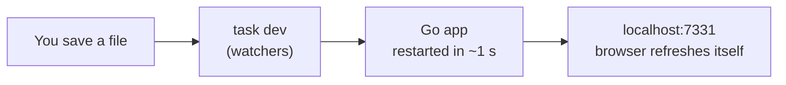

# Build plan

Last update: 2026-10-21 · Design: [architecture.md](architecture.md)

The rule: **build it locally with auto-reload first, like Flask debug mode. The container comes last.**

## How local development works (Go's version of "Flask debug mode")
- Go is compiled, but compiling takes about a second. The watcher does it for you.
- `task dev` (set up by shadcn-templ) runs three watchers at once:
  - **templ**: turns `.templ` files into Go code, restarts the app and refreshes the browser,
  - **Tailwind**: rebuilds the CSS when classes change,
  - **shadcn-templ bundle**: rebuilds the components' JavaScript.
- Open **http://localhost:7331**. That address refreshes itself whenever you save a file. Behind it, the real app runs on its own port (e.g. 8090).
- Microphone and push notifications work on `localhost` without HTTPS. HTTPS is only needed to test from a real phone (phase 3).



## Phase 0: set up the computer (once, ~20 min)
Install these (Linux commands for Omarchy/Arch; on a Mac use `brew install go` instead of `pacman`):

```bash
sudo pacman -S go
# Go puts the tools below in ~/go/bin; add it to your PATH once:
echo 'export PATH="$HOME/go/bin:$PATH"' >> ~/.zshrc
# open a new terminal so the PATH change applies, then:
go version
go install github.com/a-h/templ/cmd/templ@latest
go install github.com/go-task/task/v3/cmd/task@latest
go install github.com/axadrn/shadcn-templ/v2/cmd/shadcn-templ@latest
```
- **Tailwind v4.1+ standalone** (one file, no Node), into the same folder:
  ```bash
  curl -sSLo ~/go/bin/tailwindcss https://github.com/tailwindlabs/tailwindcss/releases/latest/download/tailwindcss-linux-x64
  chmod +x ~/go/bin/tailwindcss
  ```
- Editor: VS Code with the **Go** extension and the **templ** extension.
- Check that `templ`, `task`, `shadcn-templ` and `tailwindcss` all run from a new terminal.

## Phase 1: the beautiful fake service (no real calls yet)
Goal: every screen exists, looks like shadcn, works on mobile and desktop, in light and dark mode. **All data is fake** (hard-coded in Go).

**Start the project:**
```bash
cd ~/Documents/DEV/minivoip
shadcn-templ init -t templ        # scaffolds a templ project: Taskfile, assets, components
shadcn-templ add button card input label badge tabs dialog sidebar table
task dev                          # then open http://localhost:7331
```
Keep the `docs/` folder. Create `.gitignore` (covering `.env`, `bin/`, `tmp/`, `data/`, `assets/css/output.css`) before the first commit.

**Screens to build (in this order):**

| # | Screen | What's on it |
|---|---|---|
| 1 | **Landing page** `/` | Hero ("A phone line for your website, no phone line needed"), 3-step "how it works", live demo "Call us" button (fake), pricing (fake plans), FAQ, footer |
| 2 | **Sign up / Log in** | Email + password forms (they don't save anything yet) |
| 3 | **Dashboard overview** | KPI cards: calls today, missed calls, new voicemails; recent calls list |
| 4 | **My line** | Line name, call link, extension, QR code, the copy-paste snippet with a "Copy" button, "Make a test call" |
| 5 | **Voice menu editor** | List of options (1 = booking → ring, 2 = other → voicemail), record/upload a prompt, opening hours |
| 6 | **My phones** | Devices that ring, plus setup instructions per device (Android / iPhone / computer tabs) |
| 7 | **Voicemail** | List with play button, length, time, listened/new |
| 8 | **Call history** | Table: time, answered/missed/voicemail, length |
| 9 | **Settings** | Account name, email, password |
| 10 | **Phone app screens** `/app` | "Ready to receive calls", incoming call (big Answer/Decline buttons), in call (timer, mute, hang up), voicemail list. Phone-sized layout. |
| 11 | **Visitor call window** | What the visitor sees: menu buttons, "Waking up their phone…", in call, "Leave a message" with record button |

Done when: all 11 screens are clickable, look good on a phone and on a computer, and in light and dark mode.

## Phase 2: real accounts and data
Done 2026-10-21 (before the rest of Phase 1): SQLite with migrations (`store/`), sign up with promo code, log in/out, create a line, menu editor (typed messages read by the browser voice), call page and phone app read the database. Still to do: recorded prompts, opening hours, an admin page for promo codes.
- SQLite file in `data/minivoip.db` (`modernc.org/sqlite`); tables from [architecture.md](architecture.md#data-stored).
- Real sign up, log in, log out (bcrypt + cookie).
- Create a line, save the menu, upload/record prompts to `data/audio/`.
- Dashboard screens read real data instead of fake data.

## Phase 3: phone app install + push
Done 2026-10-21: manifest + service worker, VAPID keys made on first start (kept in the database, no `.env`), "Turn on notifications" and "Send a test" in the phone app, ringing pushes every 5 s, "Missed call" and "New voicemail" pushes. 2026-10-22: rings every 10 s (was 5), ring pushes wait up to a minute for a sleeping phone and collapse into one (push `Topic`), a late ring shows as "Missed call", answering clears the ring on other devices, and every push gets a delivery receipt (`push_log`). Still to check on Ken's real phones (Android, iPhone from the home screen).
- Web app manifest + service worker, so `/app` can be installed.
- Generate VAPID keys once, store them in `.env` (never in git; add `.env.example`).
- "Send test notification" button in the dashboard.
- To test on a real phone you need HTTPS. Pick one at that point: a local certificate (e.g. `mkcert`, used with templ's `--proxy-tls-crt`/`--proxy-tls-key`), or test on the home server behind its existing HTTPS proxy.
- Test: Android (Chrome), iPhone (added to home screen), computer.

## Phase 4: real calls (web → phone app)
Started early (2026-10-21) as a thin slice: one line in code (`lines/`), call setup in `calls/`, visitor window `/call/joesbnb`, phone app `/app`. Works on localhost; next is a real phone over HTTPS.
- WebSocket call setup (`coder/websocket`): visitor ↔ server ↔ phone app.
- Visitor's browser plays the menu, then starts a direct WebRTC call with the phone app.
- Ring all devices of the line; first to answer wins. Push to sleeping devices every ~10 s.
- Relay: `pion/turn` built in. Test on the same Wi-Fi, then phone on 4G.

## Phase 5: voicemail
Done 2026-10-21: no answer (30 s or Decline) or a voicemail choice → the browser records up to 2 minutes and uploads it; listed on the dashboard and in the phone app, play marks it heard, delete. Push "New voicemail" comes with Phase 3.
- After 30 s with no answer, the visitor's browser records a message and uploads it.
- Push "New voicemail" to the owner; play it in the phone app and dashboard.

## Phase 6: container and home server
- Dockerfile (build stage with Go + templ + Tailwind, then a tiny final image with one binary).
- `data/` folder as a volume (database + audio).
- HTTPS through Caddy or the existing proxy; open the ports listed in [architecture.md](architecture.md#firewall--ports-home-server-once-deployed).
- `task build` produces the production binary.

## Later (not planned in detail)
- Long-term direction (meeting room, whiteboard, notes, two plans): [vision.md](vision.md). Web app only; no store apps (decided 2026-10-22).
- Step 2: desk phones / SIP apps. Step 3: real phone number from a SIP provider. See [architecture.md](architecture.md#growing-later).
